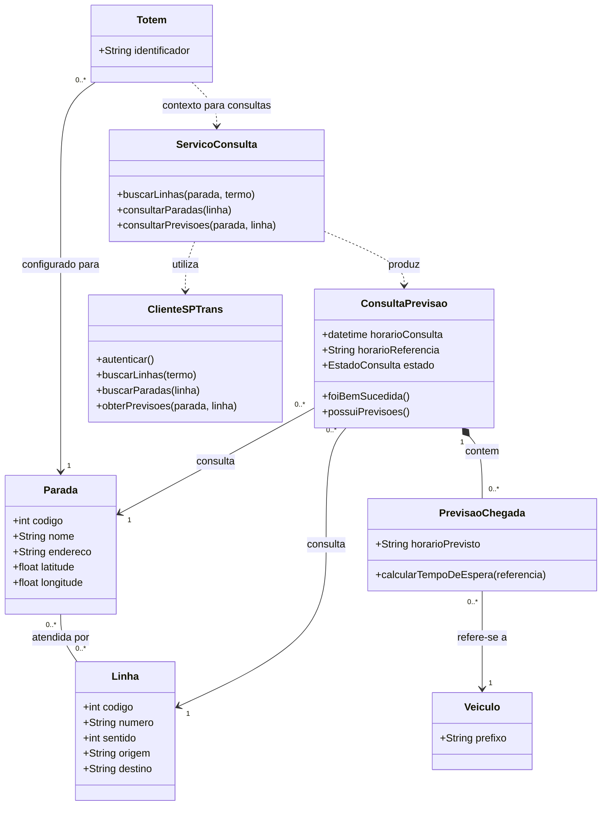

# Diagrama de classes

Modelo inicial proposto para o fluxo principal de consulta do ViaSP, com base nas histórias US01–US08 e na [arquitetura inicial](arquitetura.md). Apresenta dados, responsabilidades e operações em alto nível. Os nomes, atributos e operações são indicativos e podem mudar durante a implementação.

## Leitura do modelo

- **Totem** representa, no domínio do backend, a configuração do terminal instalado em um ponto (seu `identificador` e a **Parada** à qual está vinculado). As ações de navegação da interface do passageiro (buscar linha, selecionar linha e voltar ao início) pertencem ao frontend, que aciona as rotas HTTP do backend.
- **ServicoConsulta** coordena o fluxo no backend, considerando a parada configurada e a linha/sentido selecionados. Usa **ClienteSPTrans**, responsável pela autenticação e comunicação com a API externa. Essa divisão representa responsabilidades lógicas; não exige processos ou serviços implantados separadamente.
- Cada **Totem** está configurado para uma **Parada**. Uma parada pode atender várias linhas, e uma linha pode atender várias paradas. **Linha** representa um sentido de operação, identificado pelo código usado na integração com a SPTrans.
- Uma **ConsultaPrevisao** refere-se a uma parada e a uma linha/sentido. Guarda o horário da consulta, o horário de referência informado pela fonte e o estado do resultado, permitindo distinguir sucesso, ausência de previsão e falha, conforme US07 e US08.
- Uma consulta contém zero ou mais **PrevisaoChegada**. Cada previsão informa o horário estimado de chegada de um **Veiculo** e permite calcular o tempo de espera a partir de uma referência temporal. Uma consulta sem previsões ainda pode ter sido bem-sucedida.

As multiplicidades indicam quantos objetos podem participar de cada relação: `1` significa exatamente um e `0..*`, zero ou mais. O losango preenchido representa as previsões que compõem o resultado de uma consulta; as setas tracejadas indicam dependência de uso.

As operações descrevem comportamentos esperados, sem fixar assinaturas de código, rotas HTTP ou estratégia de persistência. O modelo ainda não representa classes implementadas.
